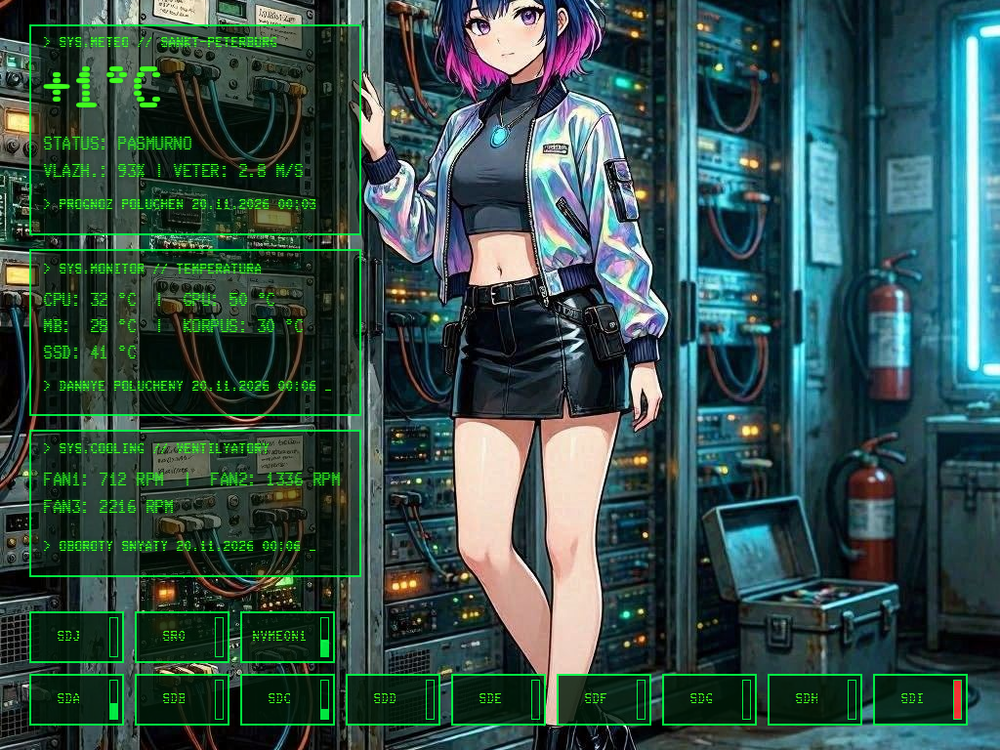

# CyberHUD

Легковесный системный и погодный монитор для рабочего стола Linux в эстетике советских ретро-терминалов (ВТА-2000). Генерирует информационный слой поверх фонового изображения и автоматически обновляет обои на выделенном мониторе через `feh`.



## Возможности

* **Погодный модуль (`SYS.METEO`):** получение текущей температуры, влажности, скорости ветра и статуса облачности через `wttr.in` с автоматической транслитерацией и кэшированием в JSON.
* **Мониторинг температур (`SYS.MONITOR`):** сбор показаний с датчиков процессора (средняя по ядрам), материнской платы, корпуса, видеокарты и NVMe-накопителей через `psutil`.
* **Контроль охлаждения (`SYS.COOLING`):** вывод оборотов подключенных корпусных и процессорных вентиляторов (RPM).
* **Состояние накопителей (`SMART` + заполненность):** автоматический поиск физических дисков через `lsblk`, отслеживание деградации SMART-атрибутов с подсветкой статуса (зеленый / желтый / красный) и визуальные индикаторы заполненности разделов.
* **Автоматический ресайз и адаптивная верстка:** подгонка фона под `1024x768` (метод `NEAREST` для сохранения пиксель-арта) и динамический расчет ширины плашек под выбранный шрифт.

## Архитектура

Проект разделен на два независимых скрипта, работающих по расписанию через `cron`:
1. `fetch_weather.py` — запускается раз в 30 минут, запрашивает свежий прогноз и сохраняет его в `weather_cache.json`.
2. `render_hud.py` — запускается каждую минуту, читает кэш погоды, опрашивает датчики железа и SMART дисков, рендерит итоговое изображение и обновляет обои на целевом дисплее (`DISPLAY=:0.1`).

## Требования

* Python 3.10+
* Утилиты Linux: `feh`, `smartmontools`, `lm-sensors`, `rsync`

Установка системных зависимостей в Ubuntu/Debian:
```bash
sudo apt update && sudo apt install -y feh smartmontools lm-sensors rsync python3-venv
```

## Установка и деплой

1. **Клонируйте репозиторий:**
   ```bash
   git clone git@github.com:ВАШ_ЛОГИН/cyberhud.git
   cd cyberhud
   ```

2. **Настройте доступ к SMART без пароля (для фоновой работы `cron`):**
   ```bash
   echo "\$USER ALL=(ALL) NOPASSWD: /usr/sbin/smartctl" | sudo tee /etc/sudoers.d/smartctl_nopasswd
   ```

3. **Настройте кастомный шрифт и фон (опционально):**
   * Замените `bg.png` на собственное фоновое изображение.
   * Положите любой понравившийся моноширинный шрифт в корень проекта под именем `font.ttf` (если файл отсутствует, будет использован системный `DejaVuSansMono-Bold.ttf`).

4. **Запустите скрипт развертывания:**
   ```bash
   chmod +x deploy.sh
   ./deploy.sh
   ```
   Скрипт скопирует проект в `~/.local/share/cyberhud`, создаст виртуальное окружение `venv`, установит Python-зависимости, создаст исполняемые команды в `~/bin` и автоматически пропишет задачи в `crontab`.

## Настройка под свое железо

* **Целевой монитор:** по умолчанию вывод настроен на изолированный экран `DISPLAY=:0.1` в функции `set_wallpaper_feh()` файла `render_hud.py`. При необходимости измените значение на `:0` или `:0.0`.
* **Город:** изменить город для прогноза можно в вызове `update_weather_cache()` в конце файла `fetch_weather.py`.
* **Датчики материнской платы:** на платах ASUS с чипами Nuvoton (`nct6775`) для отображения оборотов вентиляторов может потребоваться добавить параметр ядра `acpi_enforce_resources=lax` в `/etc/default/grub` и модуль `nct6775` в `/etc/modules`.
